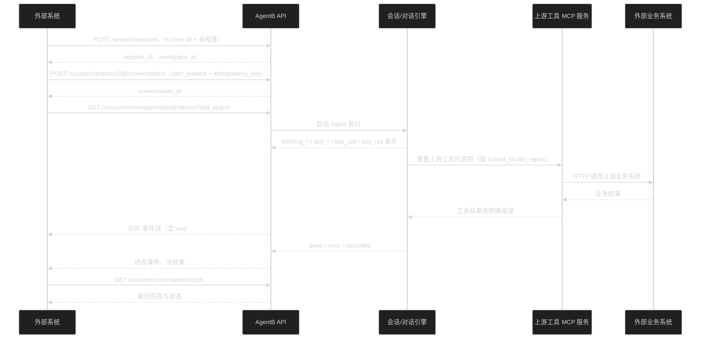
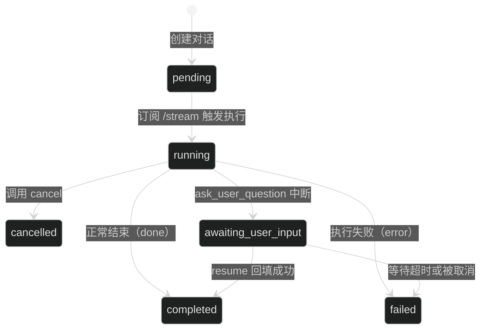

# AgentB 对外接入文档

> 适用对象：把 AgentB 接入自有业务系统、平台或智能体编排系统的开发与联调人员。
> 文档范围：AgentB **对外可调用**的 HTTP 接口、流式协议、鉴权与实例契约，以及随部署自带的上游工具 MCP 服务。
> 字段级权威定义：运行实例的 `/openapi.json` 与 `/docs`；本文档与快照 `openapi.json` 用于离线阅读。
> 本文档基于仓库主分支导出，导出时刻运行实例共 44 个路径。

## 术语

| 术语 | 含义 |
| --- | --- |
| 会话（session） | 一次业务上下文容器，含标题与工作区；一个会话下可挂多个对话 |
| 对话（conversation） | 一次「用户提问 → Agent 执行 → 回答」的完整记录，具备独立状态机 |
| 事件（event / 消息段） | 流式输出的一段结构化数据，类型见第五节 |
| 亲和键（affinity key） | 多实例部署下把同一会话的写操作固定到同一实例的路由约定 |
| 上游工具 MCP 服务 | AgentB 自带、用于调用外部业务系统（报告上传/巡查记录/AI 研判）的独立进程 |

---

## 一、部署形态与接入地址

| 形态 | 调用方访问地址 | 前缀规则 | 说明 |
| --- | --- | --- | --- |
| 直连单个 API 实例 | `http://<host>:8000` | **不带** `/api` | 便于联调；生产建议走路由 |
| 单机多实例（standalone） | `http://<host>:8152` | **带** `/api` | Nginx 一致性哈希路由，剥离 `/api` 后转发；默认只监听 `127.0.0.1:8152` |
| 平台模式（platform） | 由上层平台代理转发到 `http://agentb-router:8080` | 按平台约定，通常带 `/api` | 不发布宿主端口，仅加入平台 Docker 网络 |

要点：

1. 直连实例时**不要**带 `/api` 前缀（除设置接口自身路由为 `/api/settings`、`/api/settings/metadata`）。
2. 路由模式下 `/api` 会被 Nginx 剥离后再转发，因此调用方看到的是 `/api/session/...`。
3. 健康检查：`GET /health`（含实例信息与 `mcp` 状态）、`GET /health/ready`（就绪探针，排空时 503）、`GET /router-health`（路由层探针，仅路由端口提供）。

## 二、鉴权与实例契约

### 2.1 调用方身份

除公开路径外，所有请求必须携带请求头：

```
X-User-ID: <整数用户ID>
```

- 缺失：`401`，响应体 `{"code":401,"message":"未提供 X-User-ID","data":null}`。
- 非整数：`401`，`{"code":401,"message":"X-User-ID 必须是整数","data":null}`。
- 该用户 ID 决定会话归属：访问他人会话返回 `403`，会话不存在返回 `404`。
- 当前版本以该头作为身份标识，**没有令牌/签名校验**；`AUTH_DISABLED=1` 时服务端固定使用用户 1。因此 AgentB 必须部署在内网或网关鉴权之后（见第十四节）。

公开路径（无需 `X-User-ID`）：`/health`、`/health/ready`、`/router-health`、`/docs*`、`/openapi.json`、`/frontend*`、`/rag`、`/rag/`，以及 `/workspaces/` 前缀（工作区文件下载）。

### 2.2 实例亲和（多实例必读）

以下请求必须带亲和键，否则 `400 {"code":400,"message":"X-AgentB-Affinity-Key is required","data":null}`：

| 路径 | 方法 |
| --- | --- |
| `/session/sessions` | `POST` |
| `/session/sessions/{session_id}` 及其子路径 | `POST` / `PUT` / `PATCH` / `DELETE` |
| `/session/conversations/{conversation_id}` 及其子路径 | `POST` / `PUT` / `PATCH` / `DELETE`，以及 `/stream`（`GET`） |

约定：

1. 对既有会话的操作，键值必须等于该 `session_id`（如 `381`）；`POST /session/sessions`（创建会话）时尚无会话 ID，任意符合格式的键即可（示例用 `1`）。键名可用请求头 `X-AgentB-Affinity-Key` 或查询参数 `affinity_key`。
2. 键格式：`^[A-Za-z0-9][A-Za-z0-9._:-]{0,127}$`；格式非法返回 `400`。
3. 键值与目标会话不一致：`409`，响应体 `{"detail":"Affinity key does not match the requested session"}`。
4. 会话已被其他实例持有：`409`，响应体 `{"code":409,"message":"Session <id> is owned by instance <instance>","data":{...}}`，并带响应头 `X-AgentB-Owner-ID: <持有实例>`；应按提示把请求重放到持有实例。
5. 实例处于排空状态时新建会话：`503`，带 `Retry-After: 5`。

### 2.3 响应头

| 响应头 | 含义 |
| --- | --- |
| `X-AgentB-Instance-ID` | 处理该请求的实例标识（排障用） |
| `X-AgentB-Owner-ID` | 仅 409 归属冲突时出现，指向当前持有会话的实例 |
| `X-Request-Id` | 流式接口返回的请求标识 |

## 三、统一响应体与错误结构

业务接口成功时统一返回：

```json
{"code": 200, "message": "Success", "data": {}}
```

错误存在两种结构，接入方需要分别处理：

| 来源 | 结构 | 实测样例 |
| --- | --- | --- |
| 鉴权/亲和中间件、未捕获异常、实例归属冲突 | `{"code":<int>,"message":"<文本>","data":<任意或 null>}` | `{"code":401,"message":"未提供 X-User-ID","data":null}` |
| 路由内业务校验（FastAPI `HTTPException`）、422 参数校验 | `{"detail":"<文本>"}` 或 `{"detail":[...]}` | `{"detail":"会话不存在"}` |

常见状态码：

`400` 参数/状态非法（含亲和键缺失、非等待态调用 resume）｜`401` 缺少或非法 `X-User-ID`｜`403` 无权访问该会话｜`404` 会话/对话/工作区不存在｜`409` 亲和不匹配、会话归属冲突、等待输入超时、同会话已有运行中对话｜`413` 请求体超限（知识库文档上传单文件上限 100MB、前端日志接口 8KB）｜`415` 日志接口非 JSON｜`422` 请求体结构校验失败｜`429` 日志接口限流｜`500` 服务内部错误｜`503` 实例排空或就绪检查失败。

## 四、最小对接闭环



四步闭环：

1. `POST /session/sessions`，body `{"title":"..."}`（可省略，默认「新会话」）→ `data.id`（会话 ID）、`data.workspace_id`。
2. `POST /session/sessions/{session_id}/conversations`，body 见下表 → `data.conversation_id`。
3. `GET /session/conversations/{conversation_id}/stream?last_seq=0&mode=interactive` 接流（见第五节）。
4. `GET /session/conversations/{conversation_id}` 取最终结果与状态（适用于 `mode=silent` 或断线后补齐）。

建对话请求体：

| 字段 | 必填 | 说明 |
| --- | --- | --- |
| `user_content` | 二选一 | 纯文本提问 |
| `user_content_parts` | 二选一 | 结构化内容数组（文本 + 图片），结构见第八节 |
| `idempotency_key` | 否 | 幂等键；同一会话内重复提交不会重复建对话 |

约束：

- 同一个会话同一时刻只允许一个运行中的对话，违反返回 `409 {"detail":"当前会话已有正在执行的对话，无法创建新对话"}`。
- 会话内存在等待用户输入（`awaiting_user_input`）的对话时，不允许再建新对话：请先 `resume` 回填，或 `cancel`/等待超时（超时后该对话被标记为 `failed`）后再建。
- 对话状态为 `running` 时调用「准备消息」接口返回 `400`。

## 五、SSE 流式协议

### 5.1 连接与参数

`GET /session/conversations/{conversation_id}/stream`

| 参数 | 位置 | 默认 | 说明 |
| --- | --- | --- | --- |
| `last_seq` | query | `0` | 已消费的最后事件序号；`>0` 表示断点续传 |
| `Last-Event-ID` | header | 无 | 等价于 `last_seq`（仅当 `last_seq=0` 时生效） |
| `mode` | query | `interactive` | `interactive` 全量事件；`silent` 过滤流式中间事件，只保留心跳、终态（`done`/`error`/`cancelled`）与会话交接事件 |

响应头为 `text/event-stream` 语义（服务端使用非缓冲响应直写），`mode` 传其他值会先返回一个 `{"type":"error","message":"Invalid mode: ..."}` 事件后结束。

### 5.2 帧格式

```
id: 12
data: {"type":"text_delta","content":"...","seq":12,...}

: heartbeat
```

- 数据帧：`id: <seq>` + `data: <JSON>` + 空行。
- 心跳帧：以 `:` 开头的注释行 `: heartbeat`，用于保活；接入方应忽略而非当作错误。
- 断点续传：用已收到的最大 `id`（即 `seq`）作为下一次 `last_seq`。

### 5.3 事件字段

每个事件 JSON 固定包含：

`role`、`message_id`、`conversation_id`、`session_id`、`workspace_id`、`type`、`content`、`timestamp`、`metadata`，流式输出时额外带 `seq`。

### 5.4 事件类型

| 类型 | 用途 |
| --- | --- |
| `thinking_start` / `thinking_delta` / `thinking_end` / `thinking` | 思考过程（可用于进度展示，接入方也可整体忽略） |
| `text_start` / `text_delta` / `text_end` | 面向用户的正文增量输出 |
| `chat_start` / `chat_delta` / `chat_end` | 聊天式回复（历史回放、resume 结果发布使用） |
| `plan_start` / `plan_delta` / `plan_end` | 计划内容增量 |
| `tool_call` / `tool_res` | 工具调用与返回（含工具名、参数、结果摘要） |
| `state_change` | 执行阶段变化 |
| `conversation_handoff` | 自动续接的下一轮对话信息 |
| `compression_start` / `compression_end` | 上下文压缩开始/结束 |
| `system_alert` | 系统级告警（如上游工具 MCP 服务不可用） |
| `user_input_request` | Agent 请求用户补充信息（见第六节） |
| `error` / `cancelled` / `done` | 终态 |

### 5.5 终态与续传语义

1. `done` 表示本轮执行正常结束；`error`、`cancelled` 表示异常/取消结束；收到三者之一即可关闭连接。
2. 等待用户输入时**不会**下发 `done`，而是以 `user_input_awaiting` 提示需要调用 `resume`（见第六节）。
3. 连续约 300 个心跳周期（每 10 秒一次心跳，约 50 分钟）没有收到任何事件，服务端下发 `{"type":"error","content":"Timeout"}` 并结束；接入方应设置自身读超时并支持重连续传。
4. 对已经结束的对话发起首次订阅（`last_seq=0`）：若服务端仍保存有该轮事件则按序回放；否则返回历史回答（`chat_start`/`chat_delta`/`chat_end` + `done`）或 `stream_completed` 提示改走「查询对话」接口。
5. `seq` 仅在单个对话内有序，跨对话不做比较。

## 六、交互式问答（Agent 反问 → 调用方回填）

当任务需要补充信息时（例如确认桥梁范围），Agent 会中断并发布 `user_input_request`，其 `content` 是 JSON **字符串**：

```json
{"type":"ask_user_question","call_seq":1,"question":"需要按哪个年份做预测？","options":["2024","2025"],"context":"补充说明"}
```

对话同时进入 `awaiting_user_input` 状态，回填调用：

```
POST /session/conversations/{conversation_id}/resume
{"answer": "<用户答复文本>", "call_seq": 1}
```

校验与语义：

| 情况 | 结果 |
| --- | --- |
| 对话不在 `awaiting_user_input` | `400 {"detail":"对话不在等待用户输入状态（当前: ...）"}` |
| `call_seq` 与中断请求不一致 | `400 {"detail":"call_seq 不匹配：中断请求为 X，收到 Y"}` |
| 超过 `agent.awaiting_timeout_seconds`（默认 600 秒） | `409 {"detail":"等待用户输入超时（超过 600 秒），请创建新对话"}` |
| 服务重启或落到其他实例导致找不到可恢复现场 | `409 {"detail":"无法恢复对话: ..."}` |
| 成功 | `200`，`data.final_reply` 为最终回复；该回复同时以 `chat_start`/`chat_delta`/`chat_end` + `done` 发布到事件流 |



> 注意：恢复依赖该实例进程内的中断现场，因此 `resume` **必须命中同一实例**，请务必携带会话亲和键。

## 七、会话与对话管理

| 接口 | 方法 | 说明 |
| --- | --- | --- |
| `/session/sessions` | `GET` | 列出当前用户会话（`id`、`title`、`workspace_id`、时间） |
| `/session/sessions` | `POST` | 创建会话（需亲和键） |
| `/session/sessions/{session_id}` | `GET` / `DELETE` | 会话详情 / 删除会话 |
| `/session/sessions/{session_id}/title:generate` | `POST` | 依据对话内容生成标题（`data.title`） |
| `/session/sessions/{session_id}/conversations` | `GET` / `POST` | 会话下的对话列表 / 创建对话 |
| `/session/conversations/{conversation_id}` | `GET` | 对话详情：`user_content`、`user_content_parts`、`assistant_content`、`thinking_content`、`state`、`error`、时间戳 |
| `/session/conversations/{conversation_id}` | `DELETE` | 删除该对话 |
| `/session/conversations/{conversation_id}/cascade` | `DELETE` | 删除该对话及其之后的全部对话（回退），返回 `deleted_count` |
| `/session/conversations/{conversation_id}/cancel` | `POST` | 取消正在执行的对话 |
| `/session/conversations/{conversation_id}/messages` | `POST` | 两段式发消息：仅更新用户消息并返回 `message_id`，不触发执行（随后再订阅 `/stream`） |
| `/user/profile`、`/user/profile/name` | `GET` / `PUT` | 读取 / 修改调用方显示名 |

## 八、工作区与文件

| 接口 | 方法 | 说明 |
| --- | --- | --- |
| `/workspaces` | `GET` | 列出工作区 |
| `/workspaces/{workspace_id}` | `GET` | 工作区详情（含磁盘目录 `dir`） |
| `/workspaces/{workspace_id}/files` | `GET` | 列出工作区文件 |
| `/workspaces/{workspace_id}/files` | `POST` | 上传文件（`multipart/form-data`：`files` 多文件 + 可选 `sub_dir`） |
| `/workspaces/{workspace_id}/files/{filename}` | `GET` | 下载文件；该前缀**免鉴权**，请自行在网关上限制来源 |

消息内容（`user_content_parts`）支持两类 part：

| part | 关键字段 | 说明 |
| --- | --- | --- |
| `{"type":"text"}` | `text`（或 `content`） | 文本片段 |
| `{"type":"image"}` | `url` / `image_url` / `file_ref` / `asset_id` 任一 | 图片引用；可选 `name`、`mime_type`、`detail` |

约束与解析规则：

1. 单条消息最多 5 张图片，超出返回 `400`。
2. 图片引用写成**工作区内相对路径**（如 `测试图片.png`）时，服务端运行期解析为内联图像；引用越界或文件不存在返回 `400`。
3. 也支持 `http(s)://` 与 `data:` 形式的图片引用。
4. 不支持的 part 类型（如未知 `type`）直接返回 `400`，不做静默忽略。
5. 需要图片理解能力时，部署侧必须使用支持视觉输入的模型（见第十四节）。

## 九、计划（plan）接口

| 接口 | 方法 | 说明 |
| --- | --- | --- |
| `/plan/{workspace_id}` | `GET` | 读取计划：`exists`、`content`、`status`、`steps`、时间戳 |
| `/plan/update` | `POST` | 更新计划（body：`workspace_id`、`plan_content`） |
| `/plan/{workspace_id}/status` | `GET` | 计划状态 |
| `/plan/{workspace_id}` | `DELETE` | 删除计划文件 |

## 十、知识库（RAG）接口

所有 `/rag/api/*` 接口需要 `X-User-ID`；`/rag`、`/rag/` 是公开的静态界面。

| 接口 | 方法 | 说明 |
| --- | --- | --- |
| `/rag/api/knowledge-bases` | `GET` / `POST` | 知识库列表 / 新建 |
| `/rag/api/knowledge-bases/{kb_id}` | `PUT` / `DELETE` | 更新 / 删除知识库 |
| `/rag/api/categories/tree`、`/rag/api/categories` | `GET` / `POST` | 分类树 / 新建分类 |
| `/rag/api/categories/{category_id}` | `PUT` / `DELETE` | 更新 / 删除分类（`mode=keep_docs|unbind_docs|recursive`） |
| `/rag/api/documents/upload` | `POST` | 上传文档（`multipart/form-data`），返回入库任务 `job_id` |
| `/rag/api/jobs/{job_id}` | `GET` | 查询入库任务状态 |
| `/rag/api/documents`、`/rag/api/documents/{document_id}` | `GET` / `PUT` / `DELETE` | 文档列表与详情管理 |
| `/rag/api/documents/{document_id}/file` | `GET` | 下载原始文档 |
| `/rag/api/documents/{document_id}/categories/{category_id}` | `POST` / `DELETE` | 挂载 / 解除分类 |
| `/rag/api/documents/{document_id}/primary-category/{category_id}` | `PUT` | 设为主分类 |
| `/rag/api/files`、`/rag/api/file` | `GET` / `POST` / `PUT` / `DELETE` | 知识库文件目录读写（`/rag/api/file` 的 GET 已标记 deprecated） |
| `/rag/api/delete-jobs/{job_id}`、`/rag/api/delete-jobs/{job_id}/retry` | `GET` / `POST` | 删除任务查询与重试 |

> 入库由独立 RAG worker 进程消费队列执行；上传后应轮询 `/rag/api/jobs/{job_id}` 直到完成，再做检索类提问。

## 十一、健康检查与运维接口

| 接口 | 方法 | 说明 |
| --- | --- | --- |
| `/health` | `GET` | 实例 ID、是否排空、活跃任务/会话数、`mcp` 状态、资源占用；公开 |
| `/health/ready` | `GET` | 就绪探针；排空时返回 `503`；公开 |
| `/admin/drain` | `POST` | 触发实例排空（等待活跃任务结束后摘除路由） |
| `/router-health` | `GET` | 路由层探针（仅 Nginx 路由端口提供） |

`/health` 中的 `mcp` 对象用于判断上游工具可用性：`available`、`error`、`failure_count`、`registered`（已登记工具）、`missing`（配置登记但服务缺失）、`unlisted`（服务提供但未登记被忽略）。

## 十二、上游工具 MCP 服务（随部署自带）

上游工具（设施报告上传、设施研判预测提交、日常巡查记录回写、AI 研判问题提交）由 AgentB 自建的 MCP 服务提供，**随 AgentB 一起部署**，不需要单独对接方部署：

1. Compose 部署会在同一栈内启动服务 `agentb-mcp-upstream-tools`（`python -m mcp_servers.upstream_tools.server`，streamable-http，容器端口 8181），只在内网暴露、不发布宿主端口；单机模式与平台模式的编排文件都会带上它。
2. AgentB 作为 MCP 客户端通过 `AGENTB_MCP_UPSTREAM_TOOLS_URL`（默认 `http://agentb-mcp-upstream-tools:8181/mcp`）连接；探活为后台任务，不阻塞 AgentB 启动。
3. 该服务与 API 实例共享工作区卷（报告文件按工作区绝对路径传递），并把三个上游业务系统地址与巡查回写密钥收敛到自己那份配置里（见 `mcp/上游工具MCP服务说明.md`）。
4. 服务**启动即校验配置**（缺文件/缺段/缺字段直接退出），健康检查为 `GET /healthz`，会同时校验配置与 4 个工具是否登记齐全，异常返回 `503`。
5. 不可用时的语义：AgentB 正常启动，只在日志与 `/health.mcp` 告警；这 4 个工具不会出现在模型可见的工具协议中；调用期失败会如实失败并追加 `system_alert` 事件段，不做本地兜底。
6. 方向说明：外部系统接入 AgentB 走本文件的 HTTP/SSE 接口；AgentB **不对外暴露 MCP server**，MCP 仅是 AgentB 调用上游业务系统的方式。

## 十三、错误码与排查

| 现象 | 优先排查 |
| --- | --- |
| `401 未提供 X-User-ID` | 请求头是否携带、值是否为整数；确认路径是否属于公开路径 |
| `400 X-AgentB-Affinity-Key is required` | 写操作与 `/stream` 必须带亲和键，键值填目标 `session_id` |
| `409 Affinity key does not match the requested session` | 亲和键与会话不一致（常见于复用了上一个会话的键） |
| `409 ... is owned by instance ...` | 会话被其他实例持有；按 `X-AgentB-Owner-ID` 重放请求 |
| `409 当前会话已有正在执行的对话` | 同一会话串行使用；等待完成或先 `cancel` |
| `400 等待用户输入超时`（resume） | 超过默认 600 秒未回填；请新建对话重试 |
| 流内只有 `: heartbeat` 长时间无事件 | 任务仍在执行；确认模型/上游服务可用；必要时用 `last_seq` 重连 |
| 流内出现 `system_alert` | 上游工具 MCP 服务或上游业务系统不可用；查 `/health.mcp` 与 MCP 服务日志 |
| 报告类任务拿不到结果 | 工作区文件是否上传成功、报告生成依赖（容器内已内置 LibreOffice）是否正常 |

## 十四、边界与已知约束

1. **鉴权强度**：当前只有 `X-User-ID` 身份标识，无令牌、签名与限流；必须部署在内网，或由网关完成鉴权、来源限制与审计后再转发，并关闭对公网直接暴露的 8000/8152 端口。
2. **多实例必须带亲和键**：会话归属、事件续传与 `resume` 都依赖命中同一实例。
3. **事件续传依赖服务端存储**：默认保留 10000 条或 86400 秒（`AGENTB_STREAM_MAXLEN` / `AGENTB_STREAM_RETENTION_SECONDS`），超期后只能通过对话查询接口取最终结果。
4. **串行约束**：同一会话同一时刻一个运行中对话；同一会话内的写操作需带亲和键。
5. **能力边界**：AgentB 面向桥梁/隧道等设施业务任务，越界请求会被明确拒绝而不是猜测执行。
6. **文件下载端点免鉴权**：`/workspaces/{workspace_id}/files/{filename}` 前缀不校验身份，需依赖网关控制访问。
7. **视觉能力取决于模型**：图片理解需要部署侧配置支持图片输入的模型；否则图片会被降级为路径/占位文本处理。
8. **上游工具清单可配置**：未登记的工具即使 MCP 服务提供也不会暴露给模型，登记清单与权限见部署侧 `setting.json` 的 `agent_tools.mcp.upstream_tools`。

## 十五、变更记录

| 日期 | 内容 |
| --- | --- |
| 2026-10-11 | 首版：整理对外接口、鉴权与实例契约、SSE 协议、交互回填、工作区/RAG/计划接口、MCP 随部署说明、错误码与边界约束 |
